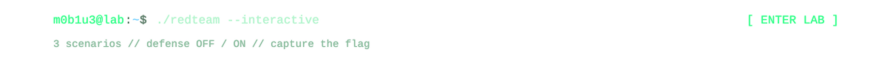

<div align="center">


<br/><br/>

<a href="https://pwned.icu"></a>
&nbsp;
<a href="https://github.com/m0b1u3"></a>
&nbsp;
<a href="https://github.com/m0b1u3?tab=repositories"></a>

<br/><br/>

<a href="https://pwned.icu/m0b1u3/#lab"></a>

</div>

<br/>

```sh
$ contributions --snake
```

<picture>
  <source media="(prefers-color-scheme: dark)" srcset="https://raw.githubusercontent.com/m0b1u3/m0b1u3/output/github-contribution-grid-snake-dark.svg">
  <source media="(prefers-color-scheme: light)" srcset="https://raw.githubusercontent.com/m0b1u3/m0b1u3/output/github-contribution-grid-snake.svg">
  
</picture>

<!-- flag part 2/2: tNGszXzF0X3M0ZjNyfQ== -->
