<a href="https://pwned.icu"><picture><source media="(max-width: 640px)" srcset="./assets/panel-website-mobile.svg?v=1"></picture></a><a href="https://github.com/m0b1u3"><picture><source media="(max-width: 640px)" srcset="./assets/panel-profile-mobile.svg?v=1"></picture></a><a href="https://github.com/m0b1u3?tab=repositories"><picture><source media="(max-width: 640px)" srcset="./assets/panel-repositories-mobile.svg?v=1"></picture></a><a href="https://pwned.icu/m0b1u3/#lab"><picture><source media="(max-width: 640px)" srcset="./assets/panel-lab-mobile.svg?v=1"></picture></a><picture><source media="(max-width: 640px)" srcset="./assets/panel-contributions-mobile.svg?v=1"></picture>

<!-- flag part 2/2: tNGszXzF0X3M0ZjNyfQ== -->
